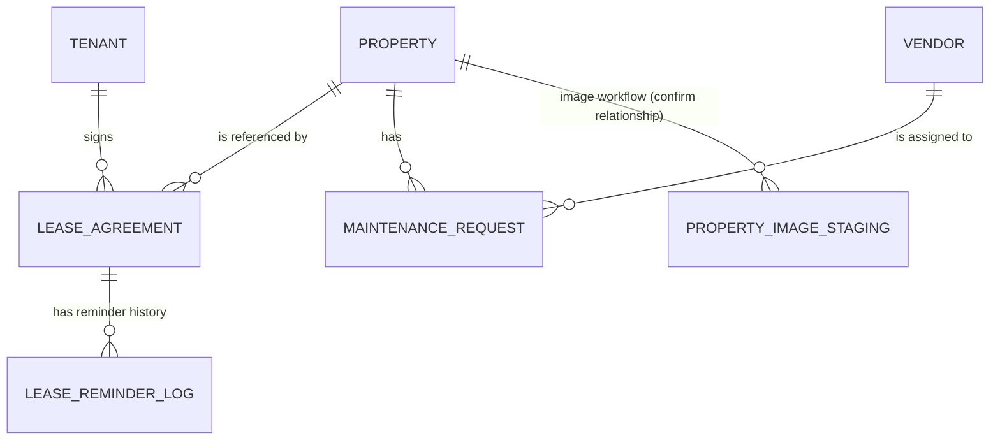

# Data Model

## Purpose

This document describes the principal custom objects identified in the source package. Confirm each object's full field inventory in Salesforce Setup or the corresponding `objects/<Object>/<Object>.object-meta.xml` and `fields/*.field-meta.xml` files before using this as a production data dictionary.

## Entity relationship overview

The diagram shows the intended relationship direction based on lookup fields and workflow names. Check the actual `referenceTo` value in each lookup field metadata file to confirm exact cardinality and delete behavior.

## Objects

### `Property__c`

Represents a property listed or managed in the application.

Known usage:
- Property exploration and filtering.
- Lease Agreement lookup.
- Maintenance Request lookup.
- Property image staging/finalization workflow.

The source package contains `Property__c` metadata. Property-specific fields include the values used by controllers and LWCs; inspect the field metadata for exact types, picklist values, required flags, and defaults.

### `Tenant__c`

Represents a tenant.

Known usage:
- Tenant management UI and `TenantController`.
- Lease Agreement lookup.
- Tenant name and email are read by `LeaseAgreementPdfController`.

Fields directly referenced by PDF controller:
- `Name`
- `Email__c`
- `Phone_Number__c` (used in test setup; confirm metadata for exact constraints)

### `Lease_Agreement__c`

Represents a lease between a tenant and a property.

| Field API name | Purpose / type summary |
|---|---|
| `Name` | Salesforce record name |
| `Tenant__c` | Lookup to tenant |
| `Property__c` | Lookup to property |
| `Agreed_Monthly_Rent__c` | Agreed monthly rent |
| `Start_Date__c` | Lease start date |
| `End_Date__c` | Lease end date |
| `Status__c` | Lease lifecycle status |
| `Terms__c` | Lease terms text |

Validation rules present in source:
- `End_Date_After_Start_Date`
- `Lease_Terms_Required`

The exact status picklist values should be read from `Status__c.field-meta.xml`; the UI/business logic should use those exact values.

### `Maintenance_Request__c`

Represents a property maintenance issue.

| Field API name | Purpose |
|---|---|
| `Property__c` | Lookup to the related property; described as required in the current project context |
| `Vendor__c` | Lookup to the assigned vendor |
| `Status__c` | Request status |
| `Description__c` | Maintenance issue description |
| `Assigned_Date__c` | Assignment date used by the application |

The current application includes a maintenance manager LWC, an Apex controller and a before-insert trigger for vendor assignment. Confirm status picklist values and defaults from metadata.

### `Vendor__c`

Represents a maintenance service provider.

Fields referenced by the project:
- `Name`
- `Email__c`
- `Is_Active__c`
- `Phone_Number__c`

The vendor assignment service uses active-vendor eligibility and workload logic. Validate whether vendors without an email or inactive vendors are excluded by current code and metadata.

### `Lease_Reminder_Log__c`

Stores lease reminder history.

| Field API name | Purpose |
|---|---|
| `Lease_Agreement__c` | Lookup to the lease |
| `Reminder_Type__c` | Type of reminder sent |
| `Sent_Date_Time__c` | Timestamp for the reminder |
| `Reminder_Key__c` | Key used to identify a specific reminder and help prevent duplicates |

**Important configuration check:** The `Reminder_Type__c` restricted picklist values must match the values written by `LeaseExpiryReminderService`. A mismatch can cause DML failures. Confirm exact values before running the batch in production.

### `Property_Image_Staging__c`

Supports the staged property image workflow used by `PropertyController`, including creation/finalization checks. The controller validates details such as staging record, session/file state, name/description/rent, and image-file requirements. Consult the object field metadata and controller for the authoritative field list and lifecycle.

## Relationship summary

| Parent / related record | Child / related record | Relationship field |
|---|---|---|
| `Tenant__c` | `Lease_Agreement__c` | `Lease_Agreement__c.Tenant__c` |
| `Property__c` | `Lease_Agreement__c` | `Lease_Agreement__c.Property__c` |
| `Property__c` | `Maintenance_Request__c` | `Maintenance_Request__c.Property__c` |
| `Vendor__c` | `Maintenance_Request__c` | `Maintenance_Request__c.Vendor__c` |
| `Lease_Agreement__c` | `Lease_Reminder_Log__c` | `Lease_Reminder_Log__c.Lease_Agreement__c` |
| `Property__c` | `Property_Image_Staging__c` | Verify lookup metadata before relying on this relationship |

## Data integrity recommendations

- Keep `End_Date__c` later than `Start_Date__c`.
- Require lease terms when the lease is saved, as configured by the existing validation rule.
- Use only configured picklist values.
- Avoid duplicate reminder records by checking the reminder key and using appropriate unique-key metadata where configured.
- Test lookup deletion behavior and required relationships in a sandbox before production deployment.
- Treat tenant contact data and lease terms as sensitive business data and grant access according to least privilege.
