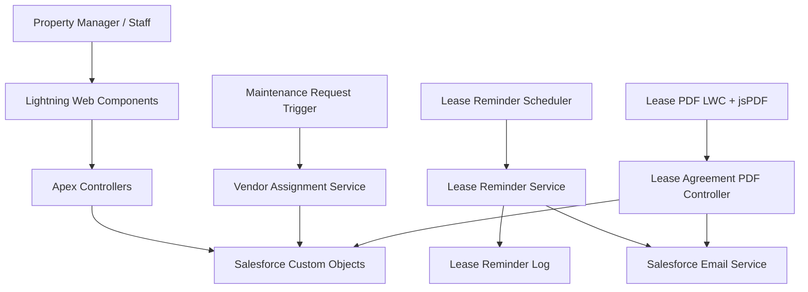

# Technical Design Document (TDD)

## 1. Purpose

This TDD describes the intended technical structure, responsibilities, interactions, key decisions and constraints of the Salesforce Real Estate Property Management project.

## 2. Design goals

- Provide a maintainable Salesforce-native solution for property, tenant, lease and maintenance workflows.
- Separate UI responsibilities from server-side business logic.
- Support bulk-safe processing where triggers and batch Apex are used.
- Respect Salesforce access controls.
- Make lease reminders auditable and resistant to duplicate processing.
- Keep the source deployable and reviewable through Salesforce DX and Git.

## 3. Logical architecture

## 4. Component responsibilities

### Property domain
`PropertyController` is responsible for server-side property operations used by the property explorer and image staging/finalization workflow. `Property__c` is the main property record.

### Tenant domain
`TenantController` provides server-side tenant operations used by `tenantManagement`. `Tenant__c` is referenced by lease agreements.

### Lease domain
`LeaseAgreementController` supports lease management operations. `Lease_Agreement__c` connects `Tenant__c` and `Property__c`, and stores rent, dates, status and terms. Validation rules enforce lease-date ordering and terms requirements.

### PDF domain
The LWC uses jsPDF in the browser to create the PDF. Apex retrieves authorized lease data and handles email delivery. This design avoids server-side PDF rendering but sends the generated Base64 PDF to Apex for attachment delivery.

### Maintenance domain
`MaintenanceController` handles UI-facing request operations. The before-insert trigger delegates to `MaintenanceVendorAssignmentService` to assign an eligible vendor. The service should remain bulk-safe and must not perform SOQL/DML inside loops.

### Reminder domain
The scheduler starts batch processing for lease expiry reminders. `Lease_Reminder_Log__c` stores reminder history and a reminder key supports deduplication. The exact reminder windows, picklist values and failure/retry policy must remain aligned between Apex and metadata.

## 5. Data model decisions

- Use custom objects for core domain entities to make the portfolio model explicit.
- Use lookup relationships between lease agreements and tenants/properties.
- Link maintenance requests to a property and optionally an assigned vendor.
- Keep reminder logs separate from lease records to preserve a history of attempted/sent reminders.
- Use a staging object for the property image workflow so upload/finalization can validate state before completing the property update.

See `DATA_MODEL.md` for the entity map and field summary.

## 6. Key technical decisions and trade-offs

| Decision | Reason | Trade-off / consideration |
|---|---|---|
| LWC + Apex | Native Salesforce UI and server-side platform logic | Requires metadata deployment and access configuration |
| Client-side jsPDF | PDF generation without a custom server rendering service | Browser library compatibility and Base64/email attachment size must be tested |
| `WITH USER_MODE` | Enforces user permissions for PDF controller queries | Users without object/field/record access will receive handled errors |
| Trigger delegates to service | Keeps trigger small and logic testable | Service must handle bulk input and no-vendor scenarios deliberately |
| Batch/scheduled Apex for reminders | Supports processing records asynchronously on a schedule | Schedule uniqueness, retry/idempotency and email limits require operational controls |
| Reminder log object | Audit trail and duplicate-check basis | Picklist values and unique key strategy must be consistent |

## 7. Error handling

- Validate null IDs, blank descriptions, blank PDF payloads, and invalid statuses at the server boundary.
- Return controlled `AuraHandledException` messages to LWCs where appropriate.
- Log or surface background processing failures through an approved operational mechanism; do not silently swallow failures.
- Keep the reminder process idempotent by checking a stable reminder key and avoiding duplicate logs/sends.
- Verify behavior when a tenant has no email address or Salesforce email delivery fails.

## 8. Non-functional requirements

### Security
- Least-privilege permissions for custom objects, fields and record access.
- No credentials in source control.
- Tenant emails, lease terms and maintenance descriptions treated as business-sensitive data.

### Performance
- Bulk-safe trigger/service design.
- Avoid SOQL and DML in loops.
- Use selective queries and appropriate batch size.
- Keep LWC loading states and user-facing errors clear.

### Reliability
- Repeatable deployment from Salesforce DX source.
- Apex test coverage for success, validation, bulk and exception paths.
- Scheduler and email behavior verified in a sandbox before production.

### Maintainability
- Separate controller, service, trigger, LWC and metadata concerns.
- Document changes and keep tests alongside Apex source.
- Use Git commits that describe a cohesive change.

## 9. Design risks / verification items

1. **Reminder picklist alignment:** Verify the service writes values that exist in the restricted `Reminder_Type__c` picklist.
2. **Duplicate reminder sends:** A log check alone may not prevent race-condition duplicates; consider a unique field/key and transaction-safe design.
3. **Bulk vendor assignment:** Verify the service balances requests in bulk, not just chooses one vendor for all rows, if balanced distribution is a requirement.
4. **PDF email limits:** Validate maximum decoded attachment size and org email limits.
5. **Access:** Test with a non-admin user to confirm expected user-mode behavior.
6. **Page placement:** Verify LWC targets and Lightning page configuration.
7. **Scheduling:** Ensure the scheduler is not installed multiple times accidentally.

## 10. Design acceptance criteria

- Core relationships and validation rules deploy as intended.
- Each LWC calls an existing, deployed Apex action.
- All Apex classes have appropriate tests with assertions.
- Negative and bulk paths are covered where relevant.
- Email, batch and trigger behavior passes target-org tests.
- Any remaining limitations are documented honestly.
